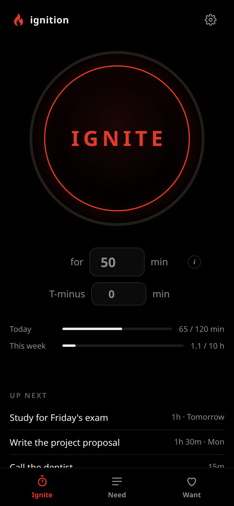
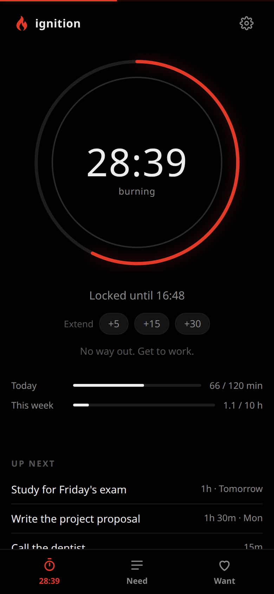

<p align="center">
  
  &nbsp;&nbsp;
  
</p>

# ignition

**A focus timer you can't cheat.** Pick how long, press **IGNITE**, and the apps, websites and programs
that eat your day are blocked until the timer runs out, on your phone and your computers at once.

Most screen-time tools fail the same way: the block is one tap from gone. A "skip for today", a PIN you set
yourself, a toggle in Settings. The moment you actually want to cave, you can, and that's the only moment
that counts. Ignition is built the other way round: **once a burn starts, there's no easy way out.** If that
sounds like too much, it probably isn't the app for you.

## Install

| You have | Do this |
| --- | --- |
| An Android phone | [Install the app](#on-your-android-phone): about 2 minutes, no account |
| A Linux computer | [Paste one command](#on-a-linux-computer) |
| Both | Do both, then [connect them](#phone-and-computers-together) |

Works on Android 10 or newer and on Linux. There's no iPhone, Windows or Mac version (yet).

### On your Android phone

The phone app works entirely on its own: no account, no server, nothing to sign up for.

1. On your phone, open the [latest release](https://github.com/ieatfood314/ignition/releases/latest) and
   tap **ignition-….apk** to download it.
2. Open the download. If Android asks, let your browser install apps, then tap **Install**.
3. Open ignition, tap the **⚙ gear → Phone → App & site blocker → Turn on**, and switch on *ignition* in the
   list Android shows you.
   > **Android says the setting is restricted?** It does that for apps that don't come from the Play Store.
   > Open Android's **Settings → Apps → ignition → ⋮** (top right) **→ Allow restricted settings**, then try
   > again.
4. Back in ignition, go to **⚙ → Blocking**. Add the websites you lose time to, pick the apps, or switch on
   **Every game**.

That's it. Press **IGNITE**.

To get updates automatically, add `https://github.com/ieatfood314/ignition` to
[Obtainium](https://obtainium.imranr.dev/).

### On a Linux computer

Open a terminal, paste this and press Enter:

```sh
curl -fsSL https://raw.githubusercontent.com/ieatfood314/ignition/main/install.sh | sh
```

It asks for your password once, because blocking sites and closing programs needs it. When it's done it
prints the address to open, normally **http://127.0.0.1:4580**. Bookmark it, then go to **⚙ → Blocking** to
choose what gets blocked.

You need Python 3 and systemd, which nearly every Linux desktop already has. To update later, run:

```sh
curl -fsSL https://raw.githubusercontent.com/ieatfood314/ignition/main/update.sh | sh
```

Use [topgrade](https://github.com/topgrade-rs/topgrade)? Put that line in `~/.config/topgrade.toml` under
`[commands]` as `"ignition" = "…"` and ignition updates along with everything else.

<details>
<summary>Rather read the script before running it?</summary>

```sh
git clone https://github.com/ieatfood314/ignition
cd ignition
less install.sh        # it's short
./install.sh
```

`./install.sh --no-blocker` installs just the app, without blocking anything on that computer.
</details>

### Phone and computers, together

Once connected, everything syncs: your lists, your burns, your settings and your block list. Start a burn on
your phone and your computer locks down within a second, and the same works the other way round.

The devices reach each other through [Tailscale](https://tailscale.com), which is free and keeps ignition
private to your own devices instead of putting it on the internet.

1. Install Tailscale on the computer and the phone, and sign in to the same account on both.
2. Install ignition on the computer ([above](#on-a-linux-computer)). With Tailscale there, the installer
   also prints an **Other devices** address, like `http://desk:8445`.
3. On the phone, go to **⚙ → Sync**, enter that address and tap **Test & save**.

**More computers?** Install Tailscale on each one, then run this on it, with the address from step 2:

```sh
curl -fsSL https://raw.githubusercontent.com/ieatfood314/ignition/main/install.sh | sh -s -- --join http://desk:8445
```

That computer gets only the blocker, and follows the burns and block list from the first one.

## Using it

**Press IGNITE.** Change the minutes first if 50 isn't right. There's a 3-second countdown (tap again to
cancel), and then you're *burning*: everything on your block list is blocked, everywhere, until the timer
hits zero.

- **A burn of an hour or less can't be ended early.** There's no stop button. It runs out when it runs out.
- **Longer burns** get a hold-to-end button, because once in a while a two-hour block really does need to
  end.
- **You can always add time** (+5, +15, +30), but never take it away.
- **T-minus** starts a burn after a delay, so you can take a break first. You can ignite early any time, but
  you can only scrub it while liftoff is more than an hour away (or in the first minute after you set it).
- **When a burn ends**, you can light a *second stage* to keep going.

The **Need** and **Want** tabs are two simple lists: things you need to do (with due dates) and things
you'd like to do someday. The top of the Need list shows under the button as *Up next*.

Settings also has **burn goals** (daily and weekly targets), **scheduled launches** that ignite on their
own at set times, and a **launch window**, where your phone nudges you to start a burn if you've been home a
while and haven't.

## What it blocks

| | On your phone | On your computers |
| --- | --- | --- |
| **Websites** | In every browser | In every browser |
| **Apps** | The ones you pick, or every game. Open one and you're sent to the home screen | Programs you name (like `steam`) are closed if started |

You set it once in **⚙ → Blocking**. With sync on, it applies everywhere.

## Questions

**Does anything get sent anywhere?** No. There's no account and no cloud. The phone blocker only looks at
which app is open and, in browsers, the address bar. Nothing is logged and nothing leaves the phone. If you
turn on sync, your devices talk only to each other, over Tailscale.

**I really, genuinely need out of a burn.** Ignition is for self-control, not security. The only person it
guards against is you. On a computer, `sudo systemctl stop ignition-enforcer` lifts every block on it.
Using that to check Reddit is between you and you.

**How do I uninstall it?** On the phone, uninstall it like any other app. On a computer, run the command
below. It won't run in the middle of a burn, and it keeps your lists in case you come back.

```sh
curl -fsSL https://raw.githubusercontent.com/ieatfood314/ignition/main/uninstall.sh | sh
```

**Where's the technical stuff?** [docs/advanced.md](docs/advanced.md) covers extra blocker options (closing
ports for self-hosted services, T3 Code, RGB lighting), Tasker, the API, how the blocking works, and
building the app yourself.

## Credits

The liftoff sound is NASA's SLS test fire, from [NASA's sound library](https://www.nasa.gov/historical-sounds/).
Courtesy NASA.
