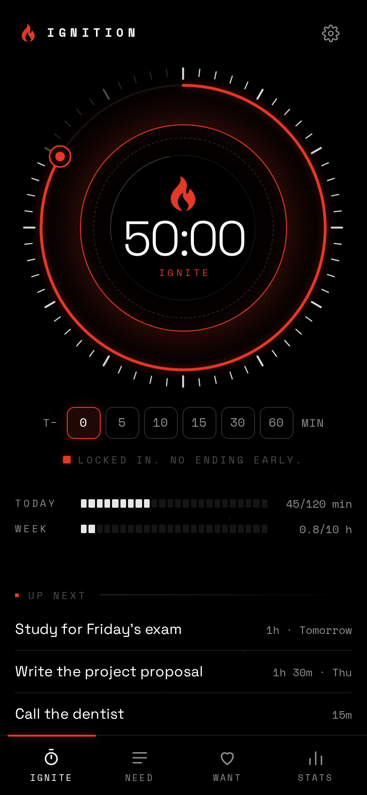
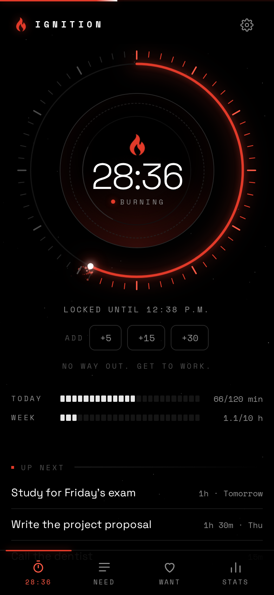

<p align="center">
  
  &nbsp;&nbsp;
  
</p>

# ignition

**A focus timer you can't cheat, and limits you can't talk your way past.** Turn the dial to how long, tap the
middle, and the apps, websites and programs that eat your day are blocked until the timer runs out, on your
phone and your computers at once. Between burns, ignition counts your screen time on every device and keeps
the limits you set, like "no games before 6 pm" or "an hour of video a day".

Most screen-time tools fail the same way: the block is one tap from gone. A "skip for today", a PIN you set
yourself, a toggle in Settings. The moment you actually want to cave, you can, and that's the only moment
that counts. Ignition is built the other way round: **once a burn starts, there's no easy way out.** If that
sounds like too much, it probably isn't the app for you.

## Install

| You have | Do this |
| --- | --- |
| An Android phone | [Install the app](#on-your-android-phone): about 2 minutes, no account |
| A Linux computer | [Paste one command](#on-a-linux-computer) |
| Both | Do both, then [connect them](#phone-and-computers-together) |

Works on Android 10 or newer and on Linux. There's no iPhone, Windows or Mac version (yet).

### On your Android phone

The phone app works entirely on its own: no account, no server, nothing to sign up for.

1. On your phone, open the [latest release](https://github.com/ieatfood314/ignition/releases/latest) and
   tap **ignition-….apk** to download it.
2. Open the download. If Android asks, let your browser install apps, then tap **Install**.
3. Open ignition, tap the **⚙ gear → Phone → App & site blocker → Turn on**, and switch on *ignition* in the
   list Android shows you.
   > **Android says the setting is restricted?** It does that for apps that don't come from the Play Store.
   > Open Android's **Settings → Apps → ignition → ⋮** (top right) **→ Allow restricted settings**, then try
   > again.
4. Back in ignition, go to **⚙ → Blocking**. Add the websites you lose time to, pick the apps, or switch on
   **Every game**.

That's it. Tap the middle of the dial to ignite.

To get updates automatically, add `https://github.com/ieatfood314/ignition` to
[Obtainium](https://obtainium.imranr.dev/).

### On a Linux computer

Open a terminal, paste this and press Enter:

```sh
curl -fsSL https://raw.githubusercontent.com/ieatfood314/ignition/main/install.sh | sh
```

It asks for your password once, because blocking sites and closing programs needs it. When it's done it
prints the address to open, normally **http://127.0.0.1:4580**. Bookmark it, then go to **⚙ → Blocking** to
choose what gets blocked.

On KDE Plasma it also adds two desktop and panel widgets: the Ignite dial and *Burn goals*. Right-click
the desktop, choose **Add Widgets** and search for *ignition*.

You need Python 3 and systemd, which nearly every Linux desktop already has. To update later, run:

```sh
curl -fsSL https://raw.githubusercontent.com/ieatfood314/ignition/main/update.sh | sh
```

Use [topgrade](https://github.com/topgrade-rs/topgrade)? Put that line in `~/.config/topgrade.toml` under
`[commands]` as `"ignition" = "…"` and ignition updates along with everything else.

<details>
<summary>Rather read the script before running it?</summary>

```sh
git clone https://github.com/ieatfood314/ignition
cd ignition
less install.sh        # it's short
./install.sh
```

`./install.sh --no-blocker` installs just the app, without blocking anything on that computer.
</details>

### Phone and computers, together

Once connected, everything syncs: your lists, your burns, your settings and your block list. Start a burn on
your phone and your computer locks down within a second, and the same works the other way round.

The devices reach each other through [Tailscale](https://tailscale.com), which is free and keeps ignition
private to your own devices instead of putting it on the internet.

1. Install Tailscale on the computer and the phone, and sign in to the same account on both.
2. Install ignition on the computer ([above](#on-a-linux-computer)). With Tailscale there, the installer
   also prints an **Other devices** address, like `http://desk:8445`.
3. On the phone, go to **⚙ → Sync**, enter that address and tap **Test & save**.

**More computers?** Install Tailscale on each one, then run this on it, with the address from step 2:

```sh
curl -fsSL https://raw.githubusercontent.com/ieatfood314/ignition/main/install.sh | sh -s -- --join http://desk:8445
```

That computer gets only the blocker, and follows the burns and block list from the first one.

## Using it

**Turn the dial, then tap the middle.** The ring works like a minute hand: drag it round (or tap the ring,
scroll, or use the arrow keys) to set the length, and keep going past twelve to add hours. For a delay, turn
the small T-minus dial underneath the same way (tap its middle to clear it). There's a 3-second countdown (tap again to scrub), then liftoff: everything
on your block list is blocked, everywhere, until the ring burns down.

- **A burn of an hour or less can't be ended early.** There's no stop button. It runs out when it runs out.
- **Longer burns** get a hold-to-end button, because once in a while a two-hour block really does need to
  end. The hour is yours to change, under *Settings › Blocking › Ending early*. During a burn you can
  only raise it.
- **You can always add time** (+5, +15, +30), but never take it away.
- **T-minus** starts a burn after a delay, so you can take a break first. You can ignite early any time, but
  you can only scrub it while liftoff is more than an hour away (or in the first minute after you set it).
- **When a burn ends**, you can light a *second stage* to keep going.

The **Stats** tab shows how much you've burned over the last week, month, year or all time, which hours of
the week you burn in, and every burn you've done.

Settings also has **burn goals** (daily and weekly targets), **scheduled launches** that ignite on their
own at set times, and a **launch window**, where your phone nudges you to start a burn if you've been home a
while and haven't.

## Screen time and limits

These need a server (a Linux computer running ignition), because they count every device together.

**Screen** shows where today went: an hour-by-hour chart by category, each device's own strip, your burns
over the top, and every app and site. *Weeks* and *Apps* look further back. Tap an app to change its category;
*Categories* lets you rename, recolour or delete the defaults and add your own. New categories can optionally
use an OpenAI-compatible AI provider to assign likely apps and sites; configure it under *Categories → AI
classification*. Phones count through Android's own usage log (allow *Screen time* under ⚙ → This phone); KDE
Plasma computers count through a small tracker the installer adds.

**Limits** close something when its time is up, on every device at once. A limit covers apps, sites or a
whole category, including your custom ones (*Play* covers every game, including ones you install later), with any mix of rules:

- **a day's allowance**: so many minutes a day (days start at 4 am);
- **a rolling allowance**: so many minutes in any few hours;
- **closed hours**: say 10 pm to 7 am, or all day;
- **within hours**: so many minutes between two times;
- **a break**: after so many minutes in a row, a rest before it opens again.

What a limit has closed can be **unlocked**, if you let it: hold a button, wait (a few minutes, or hours),
and it opens for a set time, with so many unlocks a day. An unlock counts everywhere and opens it
everywhere. There are no unlocks during a burn.

Making a limit stricter happens at once. Loosening one (or deleting it) waits, 15 minutes by default, so the
change you make in a weak moment isn't there when you want it. While limits are on, the phone also guards
the switches that would turn ignition off: its accessibility and usage access settings, uninstalling it,
and the clock.

## What it blocks

| | On your phone | On your computers |
| --- | --- | --- |
| **Websites** | In every browser | In every browser |
| **Apps** | The ones you pick, or every game. Open one and you're sent to the home screen | Programs you name (like `steam`), or every game, are closed if you start them. Already open at liftoff, they're paused until the burn ends, with a heads-up a minute before a T-minus |

You set it once in **⚙ → Blocking**. With sync on, it applies everywhere.

A closed **limit** blocks the same way, outside burns too. On the phone, the Limits page takes the screen
and says when it opens. On computers, sites are blocked and programs closed (or paused, if they were open
when the limit closed), and games running through Steam, Proton or Wine count as *Play* whatever they're
called.

## Questions

**Does anything get sent anywhere?** Only to your own server, if you set one up. There's no account and no
cloud. Without a server the phone keeps everything to itself. With one, your devices talk only to each other,
over Tailscale, and screen time sends which app was in front when, and which site (the domain, never the
address) a browser showed. Window titles and page contents are never read.

**Moving from lightcurve?** Ignition took it in. The first time the server starts after the update it brings
in lightcurve's record, limits and settings, the Plasma tracker switches itself over, and the phone app
carries on as the same device. Once ignition's app has fetched the limits, the old lightcurve app is told
there are none, so you can uninstall it.

**I really, genuinely need out of a burn.** Ignition is for self-control, not security. The only person it
guards against is you. On a computer, `sudo systemctl stop ignition-enforcer` lifts every block on it.
Using that to check Reddit is between you and you.

**How do I uninstall it?** On the phone, uninstall it like any other app. On a computer, run the command
below. It won't run in the middle of a burn, and it keeps your burns and settings in case you come back.

```sh
curl -fsSL https://raw.githubusercontent.com/ieatfood314/ignition/main/uninstall.sh | sh
```

**Where's the technical stuff?** [docs/advanced.md](docs/advanced.md) covers extra blocker options (closing
ports for self-hosted services, T3 Code, RGB lighting), Tasker, the API, how the blocking works, and
building the app yourself.

## Credits

The liftoff sound is NASA's SLS test fire, from [NASA's sound library](https://www.nasa.gov/historical-sounds/).
Courtesy NASA.

The type is [Space Grotesk](https://github.com/floriankarsten/space-grotesk) and
[Space Mono](https://github.com/googlefonts/spacemono), both under the SIL Open Font License (`web/fonts/OFL.txt`).
